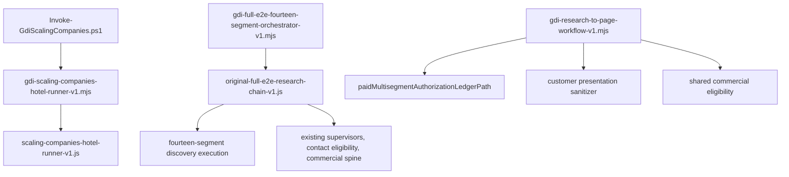

# GDI full E2E path restoration

Source-only restoration of the Tampa Scaling Companies entry points and the Aimbridge fourteen-segment chain. No paid research, publication, deployment, or hotel-store migration.

## Restored sources

| Path | Origin |
| --- | --- |
| `scripts/Invoke-GdiScalingCompanies.ps1` | `f5c709029` on `release/gdi-scaling-powershell-reproducible-baseline-v1`. SHA256 `87FEF3B95AAEAB34A49421EDA0F25A2D375F28262551B6AF62FB42DE32BB54F4` |
| `scripts/gdi-scaling-companies-hotel-runner-v1.mjs` | Same commit. SHA256 `E75E1ED4D2F50F1E718B770DEC6191CDACEA3ABF5283A6EA66EECC15961BE698` |
| Aimbridge orchestrator and chain modules | Worktree `research/aimbridge-three-hotel-full-e2e-v1` at `5e59dc69c`, including the untracked chain, discovery-state, and ledger modules |

The Tampa runner still calls `runScalingCompaniesHotelRunner` in `lib/group-demand-intelligence/research/scaling-companies-hotel-runner-v1.js`. That library was not replaced.

`scripts/dealality-gdi-full-e2e.mjs` was not recreated. The October 19 CLI has no original source in this history.

The historical Aimbridge ledger stays outside Git at `reports/gdi-aimbridge-full-e2e-live-v1/chain/paid-budget-ledger.json` in the Aimbridge worktree. SHA256 `8B1399DA85A05530977A03A64DC0197543D5A422EEDDC610FD17D4DB46424793`. It records 42 discovery cells, 38 paid discovery operations, 647 deep-research operations, and $68.50 under a $100 ceiling. It is evidence, not a current spending authorization.

Preferred Lodging uses `preferred-lodging-exa-payload-compat-v1.js` so the restored bridge calls the current prompt builders. It does not call a provider.

## Execution path

## Corrections

- Budget reconcile uses `paidMultisegmentAuthorizationLedgerPath()` when no env override is set. A ledger file without an explicit run authorization returns `historical_ledger_is_not_run_authorization` and does not authorize spend.
- Customer payloads drop provider keys at every nesting level, including `surfeEnrichment*`, `webhound*`, and `contactResearchAudit`.
- Sales Ready is blocked when independent evidence is `SPECULATIVE_DEMAND`. `CONFIRMED_DEMAND` is not assigned from generated thesis wording. `RELIABLE_INFERRED_DEMAND` remains eligible when an independent evidence quote supports it.
- Relevance synthesis processes every opportunity. The previous 60-opportunity cap is gone.
- Explicit dry-run does not persist weekly-refresh state, journals, scorecards, or an authorization ledger.

## Revised four-hotel scorecard

Immutable failed baseline `fb47a466f`: engine FAIL, events NOT VERIFIED, research NOT VERIFIED, commercial FAIL, customer delivery FAIL, publication PASS, full E2E FAIL.

This restoration, zero paid calls, stores unchanged:

| Layer | Result |
| --- | --- |
| Engine execution | PASS. Four isolated dry-runs exited 0. Local list/detail passed with 0 provider-token leaks. |
| Events orchestrator | NOT VERIFIED. Mock fixture is still missing. |
| Research quality | NOT VERIFIED. No new research was run. |
| Commercial qualification | NOT VERIFIED. Speculative Sales Ready is now 0, which removes the previous FAIL. The stores do not independently support a Sales Ready pass. |
| Customer delivery | NOT VERIFIED. Local anonymous list/detail passed. Production was not deployed. Signed-in feedback was not posted. |
| Publication safety | PASS. Spice Island published ids remain the certified seven. Bethesda published count 0. Research rows do not promote. |
| Full E2E | NOT VERIFIED. Not awarded. |

Opportunity file SHA256 values are unchanged: Bethesda `fd438549ff030ffc6f219469a526ec9b88ad8a704871fa01784d5650468226ad`, Renaissance `6eb2005f1652c79dd98f460863f53840dc3806bc23e9eae51a7214d029529c6d`, Wyndham `787826750092bd8f296dedaa1299bab1233344db3074fcc448e81dab0e046e75`, Spice Island `1fd733e32247a43446c840231b0f49ca52a6761fb9685c126a28ce22b64e0c45`. The authorization ledger mtime remains `2026-10-16T13:01:25.948Z`.

### Qualification before and after

Counts are in-memory classifications of the unchanged research stores.

| Hotel | Before thesis | After thesis | Before Sales Ready | After Sales Ready |
| --- | --- | --- | --- | --- |
| Bethesda Marriott | 51 confirmed, 4 reliable inferred, 4 speculative | 59 speculative | 9, of which 1 speculative | 0 |
| Renaissance Times Square | 27 confirmed, 40 reliable inferred, 5 speculative | 72 speculative | 10, of which 2 speculative | 0 |
| Wyndham San Diego Bayside | 36 confirmed, 40 reliable inferred, 6 speculative | 82 speculative | 8, of which 1 speculative | 0 |
| Spice Island Beach Resort | 77 confirmed | 77 speculative | 0 | 0 |

The previous confirmed and reliable-inferred labels were read from generated thesis wording. Independent evidence fields on these four stores do not contain the accommodation language required for those classes. A fixture with an independent evidence quote still classifies as confirmed or reliable inferred.

### Coverage

Evaluated opportunities: Bethesda 59 of 59, Renaissance 72 of 72, Wyndham 82 of 82, Spice Island 77 of 77. The prior run evaluated 60 for the three hotels above 60.

## Unverified external dependencies

- Airtable reuse and publication
- Live customer share and the production Railway host
- Signed-in Memberstack admin and feedback writes
- Events zero-paid fixture
- The October 19 Charlotte repair CLI
- Paid Exa, Surfe, and deep-research completion

## Remaining defects

- Full E2E is not certified. Research quality and live delivery are unverified.
- The events mock fixture is missing, so that orchestrator stays unverified.
- These four research stores need independent evidence before any row can be Sales Ready under the corrected rule.
- The historical Aimbridge deep-research run stopped externally and is not a completed full E2E.
- Operational data is still inside the Git tree. The approved migration has not been applied.
